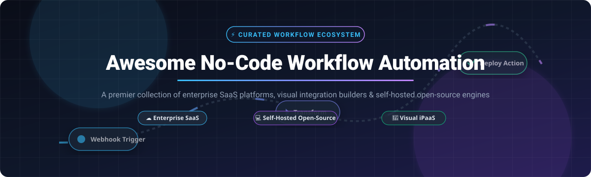

# ⚡ Awesome No-Code Workflow Automation 🚀

  
  
  
  
  
  

**Curated Directory of Top SaaS iPaaS Products & Open-Source Workflow Automation Engines**  
*Focused on Visual Flow Builders, App Integration Platforms, Enterprise Orchestrators & Self-Hosted Automation*

---

## 📖 Overview

A definitive, SEO-optimized guide tracking notable **SaaS platforms** and **open-source projects** in **No-Code Workflow Automation**, **iPaaS (Integration Platform as a Service)**, **RPA (Robotic Process Automation)**, and **Business Process Management (BPM)**. 

These visual automation tools empower growth teams, DevOps engineers, operations leads, and software developers to seamlessly connect disparate applications, orchestrate scheduled background tasks, synchronize relational data, and execute multi-step event triggers without engineering bottlenecks.

### 🌟 Key Highlights
- 🏢 **Enterprise SaaS Leaders**: Microsoft Power Automate, Jira Automation, Zapier, Workato, Make, Tray.io, Pipedream, Relay.app, and Integrately.
- 🔓 **Open-Source Powerhouses**: Mature alternatives such as n8n, Huginn, Kestra, Activepieces, Temporal, Node-RED, Windmill, Trigger.dev, and Automatisch providing local self-hosting, cost predictability, and zero vendor lock-in.
- ⚖️ **Breadth vs. Data Sovereignty**: Commercial SaaS platforms command massive integration libraries (Zapier supports 7,000+ connectors), whereas self-hosted open-source alternatives offer complete database governance, on-premise execution, and private network compliance.

---

## 📑 Table of Contents

- [📊 Sector Overview & Market Dynamics](#-sector-overview--market-dynamics)
- [☁️ SaaS & Hosted Automation Platforms](#️-saas--hosted-automation-platforms)
- [💻 Open-Source GitHub Projects & Engines](#-open-source-github-projects--engines)
- [🤝 How to Contribute](#-how-to-contribute)
- [💖 Support & Sponsoring](#-support--sponsoring)
- [⭐ Star History](#-star-history)
- [⚠️ Disclaimer](#️-disclaimer)

---

## 📊 Sector Overview & Market Dynamics

The global workflow automation and integration platform (iPaaS) market is estimated at **$13.5 billion in 2024–2025 and projected to surpass $35 billion by 2030** (growing at a CAGR of ~20–22%). 

The sector is **moderately fragmented**: mega-cap cloud incumbents (Microsoft Power Automate) and established leaders (Zapier, Workato) dominate enterprise and broad consumer adoption, but the market features healthy, sustained competition from specialized human-in-the-loop platforms and rapidly expanding self-hosted open-source ecosystems.

---

## ☁️ SaaS & Hosted Automation Platforms

| Platform | Company Size / Valuation | Starting Price | Free Tier / Trial Limits | Description |
| :--- | :--- | :--- | :--- | :--- |
| **[Microsoft Power Automate](https://powerautomate.microsoft.com/)** | ~$3.1T Market Cap (Microsoft) / >$140B ARR Cloud | $15/user/month (Power Automate Premium) | Free with Windows 11/Microsoft 365 (desktop flows only); Cloud automated flows offer a 90-day free trial with full premium connector access | Microsoft's enterprise automation platform with RPA capabilities, extensive connectors across Microsoft and third-party services, and deep integration with the Power Platform ecosystem. |
| **[Jira Automation](https://www.atlassian.com/software/jira/guides/automation/overview)** | ~$45B Market Cap (Atlassian) / >$4B ARR | Included in Jira paid tiers (Standard from $7.75/user/month) | Free tier includes up to 10 users and 100 automated rule runs/month across single projects (or 14-day free trial of Jira Cloud Premium) | Native automation within Jira; rule-based triggers and actions for issue transitions, field updates, and notifications without external tools. |
| **[Workato](https://www.workato.com/)** | $5.7B Valuation / >$150M ARR | $10,000/year base platform fee + per-recipe pricing | 30-day guided enterprise free trial with access to connectors and pre-built community recipes | Enterprise automation platform with AI-powered recipe building, low-code connectors, and comprehensive security compliance (PCI-DSS, ISO 27001, SOC 2, HIPAA). |
| **[Zapier](https://zapier.com/)** | $5.0B Valuation / >$250M ARR | $19.99/month (Starter plan, billed annually) | 100 tasks/month, 5 active single-step Zaps, 15-minute update frequency (14-day Professional trial with unlimited steps) | The market-leading no-code automation platform with **7,000+ integrations**; trigger-and-action workflows (Zaps) for connecting SaaS tools without engineering effort. |
| **[Make](https://www.make.com/)** | Celonis subsidiary (Parent valued at $13B, Make ARR >$50M) | $9/month (Core plan, 10,000 operations, billed annually) | 1,000 operations/month, 2 active scenarios, 15-minute minimum interval, 100MB data transfer limit | Visual automation platform with 3,000+ pre-built apps; Scenario Builder with If-Else, Merge, and iterators for complex data transformation. Optimized for rapid deployment with comprehensive pre-built integrations. |
| **[Tray.io](https://tray.ai/)** | $600M+ Valuation / >$30M ARR | $600/month (Pro tier starting tier) | 14-day full platform free trial with access to visual builder, standard connectors, and sandbox test runs | Low-code automation platform with powerful data transformation capabilities; workspaces and custom connector builder for complex enterprise workflows. |
| **[Pipedream](https://pipedream.com/)** | ~$100M Valuation / >$5M ARR | $29/month (Basic plan, billed annually) | 100 daily credits (approx. 3,000 credits/month), unlimited workflows, 3 concurrent executions | Developer-focused automation platform with SDKs for 3,000+ APIs, source-available component registry, and support for AI agents and workflow builders. |
| **[Relay.app](https://www.relay.app/)** | Early-stage VC-backed (~$15M–$30M Valuation) | $9/user/month (Starter tier, billed annually) | 100 runs/month, unlimited workflows, 1-minute run delay, standard human-in-the-loop approvals | No-code automation platform focused on human-in-the-loop workflows; designed for multi-step processes where human judgment is required at specific points. |
| **[Integrately](https://integrately.com/)** | Bootstrapped / >$3M ARR | $19.99/month (Starter plan, billed annually) | 100 tasks/month, 5 active 1-to-1 automations, 15-minute update frequency (14-day trial of paid plan) | No-code automation platform with pre-built automation templates and a focus on simplicity for small businesses. |

---

## 💻 Open-Source GitHub Projects & Engines

The following table lists leading open-source workflow automation platforms, self-hosted integration engines, and orchestrators, sorted in descending order by GitHub stargazers:

| Platform | Stars | License | Architecture & Focus | Description |
| :--- | :--- | :--- | :--- | :--- |
| **[n8n](https://github.com/n8n-io/n8n)** |  | Fair-code (Sustainable Use) | Visual node-based workflow builder | The **most established open-source workflow automation platform**. Combines visual building with custom JavaScript/Python code; **400+ integrations** and 9,000+ workflow templates; native AI agent workflows with full self-hosting and data sovereignty. |
| **[Huginn](https://github.com/huginn/huginn)** |  | MIT | Agent-based event monitoring & scrapers | Hackable event-driven automation platform ("build an open-source Yahoo! Pipes or IFTTT"). Runs online agents that monitor web feeds, parse DOM elements, scrape sites, and execute automated actions on custom events. |
| **[Kestra](https://github.com/kestra-io/kestra)** |  | Apache 2.0 | Declarative YAML orchestration | An **event-driven, declarative orchestration platform**. Defines workflows in YAML; executes tasks across any runtime (SQL, Python, shell, Go, Java, Docker); features **500+ plugins**, namespace isolation, and real-time execution tracking. |
| **[Activepieces](https://github.com/activepieces/activepieces)** |  | MIT | Visual Zapier/Make alternative | The **strongest MIT-licensed Zapier alternative**. Features **500+ integrations** (pieces), unlimited task executions on self-hosted instances, and a hybrid visual builder allowing seamless TypeScript extension. |
| **[Temporal](https://github.com/temporalio/temporal)** |  | MIT | Durable execution workflow engine | Open-source **durable execution platform** for mission-critical, long-running stateful workflows. Workflows are defined in code (Go, Java, TypeScript, Python) with automatic replay, persistence, and distributed state recovery. |
| **[Node-RED](https://github.com/node-red/node-red)** |  | Apache 2.0 | Low-code flow-based programming | Low-code browser-based visual programming tool for wiring together hardware devices, APIs, and online services. Highly extensible ecosystem with thousands of community nodes (palettes). |
| **[Windmill](https://github.com/windmill-labs/windmill)** |  | AGPL-3.0 | Developer-first workflow & UI engine | Build multi-step workflows, scripts, and internal user interfaces in **TypeScript, Python, Go, and Bash**. Features visual flow composition, Workflow-as-Code, fast execution runtimes, cron scheduling, and webhooks. |
| **[Trigger.dev](https://github.com/triggerdotdev/trigger.dev)** |  | Apache 2.0 | Developer background jobs & workflows | Modern background jobs and orchestration platform built for TypeScript. Handles long-running jobs, real-time logging, retries, step delays, and serverless execution without timeouts. |
| **[Automatisch](https://github.com/automatisch/automatisch)** |  | AGPL-3.0 | Pure no-code Zapier alternative | Privacy-focused business automation tool allowing teams to connect software services without writing a single line of code. Designed specifically for full GDPR compliance and on-premise execution. |
| **[Pipedream](https://github.com/pipedreamhq/pipedream)** |  | Apache 2.0 (Component registry) | Integration component registry & SDK | Open repository of integration components and actions across thousands of APIs for Pipedream's serverless visual workflow automation platform. |
| **[Inngest](https://github.com/inngest/inngest)** |  | Apache 2.0 | Event-driven durable step functions | Developer orchestration engine that turns any codebase into durable event-driven workflows with zero infrastructure setup. Supports step-level retries, scheduling, and concurrency management. |

---

## 🤝 How to Contribute

Contributions are always warmly welcomed! 💡

1. 🍴 Fork the repository.
2. ✍️ Add or update entries in `README.md` following the established tabular structure.
3. 🔍 Ensure descriptions remain factual, neutral, and include verifiable pricing or GitHub metrics.
4. 🚀 Open a Pull Request with a concise explanation of your additions.

🌟 Don't forget to **Star** the repository if you find it helpful!

---

## 💖 Support & Sponsoring

Thank you so much for exploring and using this repository! If this curated list helped you or your team discover the ideal workflow automation stack, please consider supporting the project:

- ⭐ **Star this repository** to improve discoverability for other developers and operators.
- 🍴 **Fork and share** it with your developer community, colleagues, and social channels.
- ☕ **Buy me a coffee / Sponsor the project**: Support continued open-source curation and tool tracking via the official [GitHub Sponsor Dashboard](https://github.com/sponsors/ishandutta2007).

---

## ⭐ Star History

---

## ⚠️ Disclaimer

- 📌 This is a **community-curated** directory — not exhaustive and not a commercial endorsement.
- 🔐 No-code workflow automation platforms handling business data and credentials must comply with applicable privacy regulations and organizational security policies; **self-hosted solutions place full responsibility for security patches, backups, and uptime on the operator**.
- 📜 **Licensing varies significantly across open-source solutions**:
  - **Activepieces** is MIT-licensed (fully permissive for commercial use and modification).
  - **n8n** utilizes a fair-code license (sustainable use, non-OSI approved with resale limitations).
  - **Windmill** and **Automatisch** utilize AGPL-3.0 (copyleft for network use).
  - **Kestra**, **Node-RED**, **Trigger.dev**, and **Inngest** use Apache 2.0.
  - Always verify licensing terms before commercial self-hosting or embedding.

---

  Made with ❤️ for automation builders, DevOps engineers, and organizations scaling visual workflows.

